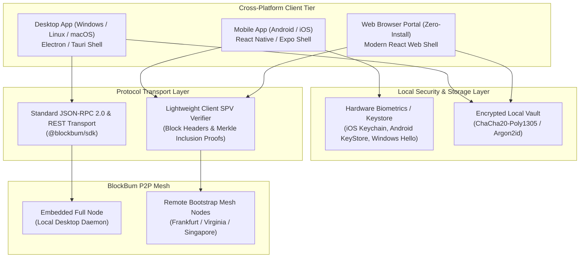

# BlockBum Global Application Ecosystem Specification

## 1. Overview & Vision

The BlockBum Global Application Ecosystem expands the native C++20 blockchain core into a unified, accessible, and censorship-resistant client experience across **Desktop (Windows, Linux, macOS)**, **Mobile (Android, iOS)**, and **Web Browser**.

### Core Axiom: Zero Frontend Consensus Divergence
> [!IMPORTANT]
> The frontend user interfaces never implement competing blockchain consensus or transaction validation logic. All consensus verification, fork-choice evaluation, state transition execution, and cryptographic validation are strictly governed by the BlockBum protocol specification and validated via the node core.

---

## 2. Multi-Platform Topology

---

## 3. Client Execution Modes: Full Node vs Light Client (SPV)

To serve diverse hardware constraints without compromising user sovereignty, BlockBum defines two standard execution modes:

| Security Metric | Full Node Mode (Desktop / Server) | Lightweight Client (SPV) Mode (Mobile / Web) |
| :--- | :--- | :--- |
| **Trust Model** | Trustless (self-validating) | Trust-minimized (validates headers + Merkle proofs) |
| **Data Downloaded** | Full block history, transaction bodies, CAS state | 92-byte block headers only |
| **Initial Sync Time** | ~1–5 minutes (headers-first) | < 1 second |
| **Storage Usage** | ~1–2 GB (pruned: ~50 MB) | < 1 MB |
| **Transaction Verification** | Direct execution against local RocksDB ledger | Merkle inclusion path verified against block header |
| **Double-Spending Defense** | Local state machine verification | Validated by block height and PoW difficulty accumulators |
| **Target Platforms** | Windows, Linux, macOS workstations | Android, iOS, Browser Web Portal |

---

## 4. Multi-Device Identity Protocol

Users maintain one unified sovereign identity across multiple paired devices without entrusting private keys to a third-party server.

### 4.1 Device Pairing Workflow
1. **Initiation**: The primary device generates an ephemeral pairing session token ($S_{pair}$) and renders it as a QR code.
2. **Camera Scan**: The secondary device (e.g., Android phone) scans the QR code and generates a device-specific keypair $(PK_{dev}, SK_{dev})$.
3. **Authorization Signature**: The primary device signs the secondary device's public key with its master Ed25519 identity key:
   $$\sigma_{auth} = \text{Sign}_{SK_{master}}(PK_{dev} \parallel \text{device\_name} \parallel \text{timestamp})$$
4. **Relay Synchronization**: The authorization certificate is synced across devices, granting the secondary device access to the encrypted communication mesh.

### 4.2 Revocation
The user can revoke any paired device at any time. The master identity signs a `DeviceRevocationRecord`, which is gossiped to P2P mailboxes and Double Ratchet sessions, instantly dropping the revoked device from future message decryption ratchets.

---

## 5. Encrypted Local Storage Architecture

To defend against physical device theft and unauthorized extraction:
- **Master Key Derivation**: User master password is expanded using Argon2id ($t=3, m=64\text{MB}, p=4$) into a 256-bit key.
- **Cipher**: ChaCha20-Poly1305 authenticated encryption with randomized 96-bit nonces.
- **Inactivity Timeout**: Configurable auto-lock (default 15 minutes) wipes decrypted keys from memory.
- **Mobile Hardware Sealing**: On Android and iOS, keys are protected by the hardware Secure Enclave / Titan M2 chip, requiring biometric authentication (Face ID / Fingerprint) before decryption.

---

## 6. Localization & Accessibility Standards

### 6.1 Localization (i18n)
All user interfaces natively support 7 languages:
- English (`en`), Spanish (`es`), Chinese (`zh`), German (`de`), French (`fr`), Hindi (`hi`), Japanese (`ja`).

### 6.2 Accessibility (a11y)
- **High Contrast**: Meets WCAG 2.1 AAA standards with pure `#000000` background and high-contrast text.
- **Font Scaling**: Dynamic multiplier supporting Normal (100%), Large (115%), and Extra-Large (130%).
- **Reduced Motion**: Disables transitions and animations when requested by system settings.
- **Screen Reader Support**: All interactive elements provide explicit `aria-label`, `role="tab"`, and semantic landmarks.

---

## 7. "Blockchain-Invisible" User Experience Guidelines

To achieve mass adoption, BlockBum enforces plain-language UI principles:
1. **Account ID** replaces "cryptographic public key / Bech32 address hash".
2. **Transfer** replaces "serialize, sign, and broadcast state transition".
3. **Network Fee** is displayed in plain currency equivalents alongside atomic BUM units.
4. **Safety Phrase** replaces "BIP-39 mnemonic seed vector".
5. **Syncing** replaces "headers-first PoW accumulated difficulty tree traversal".
