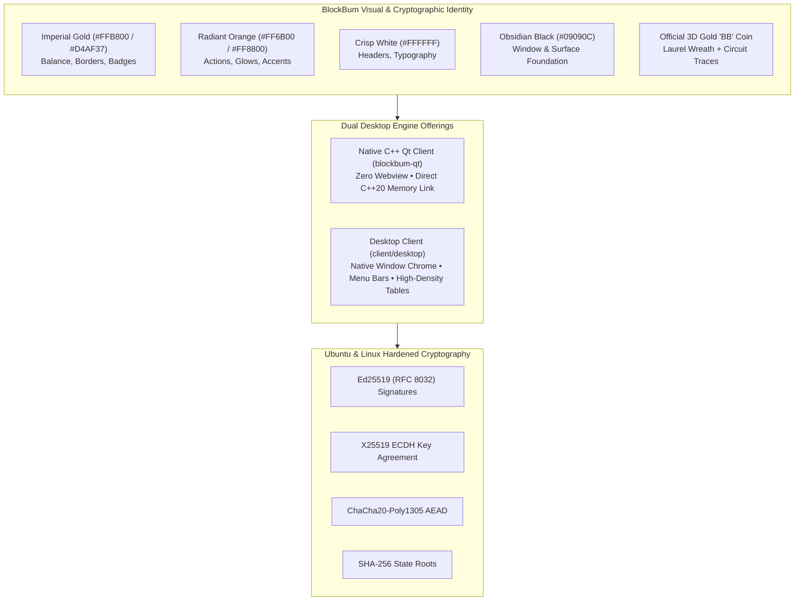

# BlockBum Desktop Core Application Specification

## 1. Executive Summary & Brand Identity

The **BlockBum Desktop Client** has been redesigned from the ground up to embody a true **Desktop Core Application** experience, eliminating web-like styling in favor of high-performance desktop architecture.

The visual design language strictly conforms to the official brand identity:
* **Imperial Gold (`#FFB800` / `#D4AF37` / `#FFD700`)**: Used for coin balances, primary branding, active state highlights, and metallic gradient accents.
* **Radiant Orange (`#FF6B00` / `#FF8800` / `#FF5500`)**: Used for action buttons (Send BUM, Broadcast), glowing neon alerts, and key interactive controls.
* **Crisp Pure White (`#FFFFFF` / `#F8FAFC`)**: Used for primary typography, titles, and high-contrast data readouts.
* **Obsidian Black (`#09090C` / `#111116` / `#161622`)**: Deep black foundations matching the glossy background of the official 3D Gold "BB" Crypto Coin.

---

## 2. Desktop Core Architecture (Eliminating "Web Look Appeal")

To deliver a native desktop application rather than a website inside an executable:

1. **Integrated Window Titlebar**:
   * Includes custom window dragging (`-webkit-app-region: drag`), official 3D Gold "BB" Coin emblem, network connectivity pill (`● Connected | 8 Peers`), and minimize/maximize/close window controls.
2. **Desktop Application Menu Bar**:
   * Features native drop-down menus: `File`, `Wallet`, `Send/Receive`, `Transactions`, `Messages`, `Network`, `Security`, and `Help`.
   * Desktop keyboard accelerators: `Ctrl+N` (New Identity), `Ctrl+S` (Send), `Ctrl+R` (Receive), `Ctrl+L` (Lock Vault), `Ctrl+Q` (Exit).
3. **Left-Rail Desktop Dock**:
   * High-density icon tabs (`Wallet & BUM`, `Private Messages`, `Communities`, `Governance & BIPs`, `Decentralized Files`, `Global P2P Network`, `Multi-Device Security`, `System & Cryptography`).
   * Tactile feedback with amber borders and neon orange indicators.
4. **Desktop Data Tables**:
   * High-density ledgers with monospaced hashes, Bech32 addresses (`bb1...`), confirmation counters, and copy buttons.
5. **Fixed Layout & Desktop Status Bar**:
   * No full-window browser scrolling; pane-specific scrolling with custom slim gold scrollbars.
   * Persistent 26px bottom status bar showing Chain Height, Difficulty, Mempool Txs, Execution Mode, Ubuntu Cryptography status, and Peer Count.

---

## 3. Native C++ Qt Client (`blockbum-qt`)

For users and operators desiring a 100% native desktop application without web frameworks:

* **Location**: `src/qt/`
* **Entry Point**: `src/qt/main.cpp`
* **Key Components**:
  * `MainWindow` (`mainwindow.hpp` / `mainwindow.cpp`): Native Qt window with menu bars, toolbars, and status bars.
  * `OverviewPage` (`overviewpage.hpp` / `overviewpage.cpp`): Native widget displaying spendable BUM balance, 3D Gold Coin, Bech32 address, and recent transactions.
  * `SendCoinsDialog` (`sendcoinsdialog.hpp` / `sendcoinsdialog.cpp`): Native dialog to sign and broadcast BUM transactions using Monocypher Ed25519.
  * `ReceiveCoinsDialog` (`receivecoinsdialog.hpp` / `receivecoinsdialog.cpp`): Native dialog to inspect and copy receive address.
  * `style.qss`: Complete Qt stylesheet applying the Obsidian Black, Imperial Gold, Radiant Orange, and Crisp White palette.
* **CMake Target**: Automatically configured when Qt6 or Qt5 is available; cleanly skipped when building in headless CI environments.

---

## 4. Ubuntu Cryptographic Subsystem Audit

All desktop clients link directly or communicate with the hardened cryptographic core:
* **Digital Signatures**: Monocypher Ed25519 (RFC 8032) constant-time signing and verification.
* **Key Agreement**: X25519 (RFC 7748) Elliptic Curve Diffie-Hellman for end-to-end encrypted messaging.
* **Symmetric Encryption**: ChaCha20-Poly1305 (RFC 8439) AEAD with 256-bit keys for local vault protection.
* **Hashing & Merkle Trees**: SHA-256 (FIPS 180-4) for transaction IDs, block headers, and Merkle audit paths.
