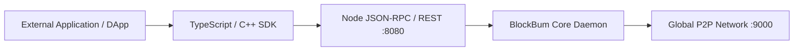

# BlockBum Developer Onboarding Guide

Welcome to the **BlockBum Developer Ecosystem**. This guide explains how to connect to a BlockBum node, generate cryptographic identities, assemble and sign transactions, and interact with decentralized messaging and content-addressed storage.

---

## 1. Quickstart Architecture



Developers interact with the network via:
1. **TypeScript SDK** (`@blockbum/sdk`): For web applications, wallets, bots, and Electron/Node.js apps.
2. **C++ Developer Library** (`blockbum/sdk.hpp`): For native high-performance daemons and validator tooling.
3. **HTTP REST & JSON-RPC 2.0**: For language-agnostic integration (Python, Rust, Go, curl).

---

## 2. Using the TypeScript SDK

### 2.1 Installation
```bash
npm install @blockbum/sdk
```

### 2.2 Generating an Identity & Requesting Testnet Tokens
```typescript
import { BlockBumClient, Wallet } from '@blockbum/sdk';

async function run() {
  const client = new BlockBumClient('http://localhost:8080');

  // 1. Create a fresh Ed25519 identity
  const wallet = new Wallet();
  const alice = wallet.createIdentity('alice');
  console.log(`Address: ${alice.address}`);

  // 2. Request 10 tBUM from the testnet faucet
  const faucet = await client.requestFaucet(alice.address);
  console.log(`Faucet Dispensed: ${faucet.amount_bum} tBUM (Tx: ${faucet.tx_id})`);

  // 3. Inspect confirmed balance
  const account = await client.getAccount(alice.address);
  console.log(`Confirmed Balance: ${account.balance_bum} tBUM`);
}

run().catch(console.error);
```

---

## 3. Using the C++ Developer Library

Third-party C++ applications include the single unified header `#include <blockbum/sdk.hpp>` and link `blockbum_core`.

### 3.1 Creating, Signing, and Verifying a Transaction
```cpp
#include <blockbum/sdk.hpp>
#include <iostream>

int main() {
    blockbum::sdk::BlockBumClient client;

    // 1. Generate identity
    auto sender = client.generate_keypair("sender");
    std::string recipient = "bb1_recipient_address_40hex...";

    // 2. Build transfer transaction (50 BUM = 50,000,000 atomic units)
    auto tx = client.build_transfer(
        sender.address,
        sender.public_key,
        recipient,
        50'000'000,
        1 // Sequential nonce
    );

    // 3. Cryptographically sign transaction
    client.sign_transaction(tx, sender.private_key);

    // 4. Verify signature validity
    if (client.verify_transaction(tx)) {
        std::cout << "[VALID] Transaction " << blockbum::core::to_hex(tx.tx_id) << " verified!\n";
    }

    return 0;
}
```

---

## 4. Off-Chain Messaging & Decentralized Storage APIs

### 4.1 End-to-End Encrypted Messaging (Double Ratchet)
Private communications use the Signal-style Double Ratchet protocol with RFC 7748 X25519, RFC 8439 ChaCha20-Poly1305, and BLAKE2b:
- **Forward Secrecy**: Handled via symmetric KDF chains.
- **Post-Compromise Security**: Handled via ephemeral DH ratchet steps.
- **Off-Chain Rule**: Plaintext chat messages and media files are **never** published to the on-chain blockchain ledger. Only zero-knowledge blinded tokens or cryptographic proofs are exchanged through offline relays.

### 4.2 Content Storage & Proof of Retrievability (PoR)
- Uploaders chunk content into 1 MB shards and publish content manifests.
- Storage providers submit cryptographic Proofs of Retrievability ($\text{SHA256}(\text{chunk} \parallel \text{salt} \parallel \text{provider\_id})$) to claim lease escrow rewards.

---

## 5. Public Testnet Explorer & Faucet

- **Web Explorer**: Available at `http://localhost:8080` (or `client/explorer/index.html`).
- **Interactive Search**: Query by block height, hash, transaction ID, or address.
- **Developer Faucet**: One-click token dispenser rate-limited to 1 request/hour per address/IP.
