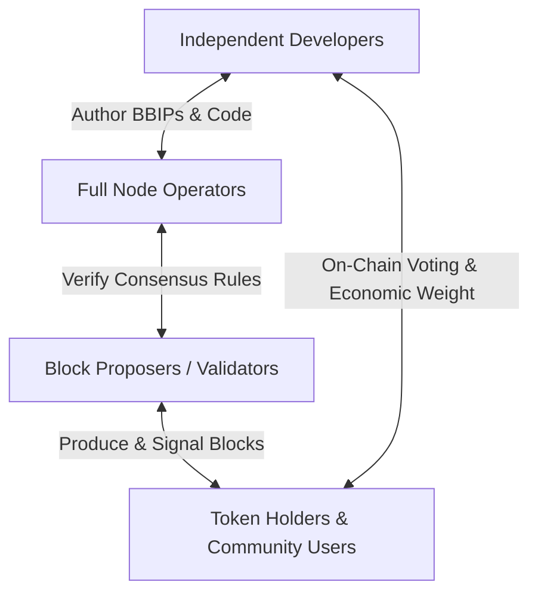

# BlockBum Decentralized Governance Framework

## Document Metadata
- **Protocol Version**: 1.0.0
- **Status**: Official Governance Specification (Phase 18)
- **Scope**: On-Chain Voting, BBIP Standards, Upgrade Procedures, Timelocks, Emergency Policies

---

## 1. Governance Philosophy & Principles

The governance framework of BlockBum is designed to ensure that the protocol remains a **globally decentralized, permissionless, and censorship-resistant public utility**.

> [!IMPORTANT]
> **Core Governance Axioms**:
> 1. **No Unilateral Control**: No single developer, corporation, foundation, or validator cartel possesses administrative keys, backdoors, or unilateral authority over the public network.
> 2. **Code is Enforced by Validating Nodes**: Every full node independently validates blocks, transactions, and state transitions against the mathematical rules of consensus. A proposal or vote that violates consensus rules is unconditionally discarded by honest nodes.
> 3. **Separation of Concerns**: Community preferences, grant allocations, and signaling are cleanly separated from consensus-critical rule changes.
> 4. **Inviolability of Private Property**: Governance mechanisms **cannot** modify user balances, confiscate coins, alter cryptographic signatures, or bypass nonce replay checks.

---

## 2. Stakeholder Participation Matrix

BlockBum balances power among four distinct stakeholder groups, ensuring checks and balances:

| Stakeholder Group | Primary Role | Governance Power | Enforcement Mechanism |
|---|---|---|---|
| **Independent Developers** | Author BBIPs, implement client software, review cryptography, discover vulnerabilities | Propose technical innovations, publish reference implementations | Open-source pull requests, public code reviews |
| **Full Node Operators** | Run independent validating nodes, preserve blockchain history, verify state rules | Decide which client software and consensus rules to run | Reject invalid blocks; choose which chain branch to follow |
| **Validators / Miners** | Order transactions, compute block proofs, provide network liveness | Signal readiness for soft-forks; execute scheduled proposals | Block header version bit signaling |
| **Token Holders / Users** | Use network services, tip creators, participate in on-chain signaling | Vote on treasury grants, parameter changes, and meta-proposals | Cryptographic on-chain vote casting; market choice |

---

## 3. Proposal Lifecycle & On-Chain Voting Mechanics

### 3.1 Proposal Categories & Approval Rules

| Category | Description | Quorum | Approval Threshold | Timelock Delay | Binding Nature |
|---|---|---|---|---|---|
| **Core / Consensus** | Block rules, proof system, halving, wire format | 20% | **66.7% Supermajority** | 30 Days (Mainnet) | Signaling (Requires node upgrade) |
| **Network Protocol** | P2P framing, peer scoring, discovery protocols | 15% | **60.0% Supermajority** | 14 Days (Mainnet) | Technical consensus & client release |
| **Treasury Grant** | Allocations from `bb1_community_treasury` | 10% | **> 50.0% Simple Majority** | 100 Blocks (DevNet) / 14 Days | **On-Chain Binding** |
| **Parameter Change** | Fee rates, memory limits, storage lease defaults | 15% | **> 50.0% Simple Majority** | 7 Days (Mainnet) | Config / Node update |
| **Community Meta** | Process guidelines, ecosystem roadmaps | 5% | **> 50.0% Simple Majority** | 0 Days | Non-binding sentiment signal |

### 3.2 Proposal Lifecycle States

```mermaid
stateDiagram-v2
    [*] --> Draft: Submitter deposits anti-spam bond
    Draft --> Active: Voting period starts at block H_start
    Active --> Passed: Voting ends at H_end; Quorum & Threshold met
    Active --> Defeated: Voting ends; Quorum or Threshold failed
    Active --> Cancelled: Withdrawn by proposer before H_end
    Passed --> Queued: Placed in execution timelock queue
    Queued --> Executed: Timelock elapses at H_exec; Action applied
    Queued --> Cancelled: Emergency security cancellation
```

### 3.3 Anti-Spam & Sybil Prevention
1. **Proposal Deposit**: Submitting an on-chain proposal requires a deposit of `1,000 BUM` (refundable if the proposal reaches quorum).
2. **Snapshot Block Height**: Voting power is locked at the proposal's `snapshot_height` ($H_{\text{snapshot}} < H_{\text{start}}$), preventing flash-loan or temporary capital borrowing attacks.
3. **Single Vote Invariant**: Every voter can cast exactly one vote (`Yes`, `No`, or `Abstain`). Re-voting or double-voting on the same proposal ID is cryptographically prevented.

---

## 4. Protocol Upgrade Procedures

### 4.1 Soft Forks (Backward-Compatible Rule Tightening)
1. **Specification**: Approved via Standards Track BBIP (Core/Consensus).
2. **Implementation**: Merged into release with a feature flag linked to block header version bits (`BlockHeader.version`).
3. **Signaling**: Proposers signal readiness by setting the designated version bit in mined blocks.
4. **Activation**: If $\ge 90\%$ of blocks in an epoch (e.g. 2,016 blocks) signal the bit, the soft fork locks in and activates after a 14-day grace period.

### 4.2 Hard Forks (Backward-Incompatible Rule Changes)
1. **Specification**: Exhaustively documented BBIP with migration test vectors.
2. **Rough Consensus**: Broad consensus across all node operators, developers, and economic participants.
3. **Activation Height**: A deterministic block height $H_{\text{activation}}$ is selected months in advance.
4. **Independent Node Choice**: Node operators voluntarily upgrade. Nodes that do not upgrade remain on the legacy branch.

---

## 5. Timelocks & Emergency Security Procedures

### 5.1 Mandatory Execution Timelocks
To prevent surprise governance attacks or flash governance capture, approved proposals must reside in the `Queued` state for a mandatory timelock delay:
$$\text{Height}_{\text{execution}} = \text{Height}_{\text{voting\_end}} + \text{TimelockDelay}$$
During the timelock window:
- Node operators and users review the pending state change.
- Any participant who disagrees with an impending change has ample time to exit or fork.

### 5.2 Emergency Security Actions & Circuit Breakers
If a critical zero-day vulnerability is discovered:

1. **Responsible Disclosure**: Security researchers submit disclosures via encrypted PGP to `security@blockbum.net`.
2. **Module-Specific Circuit Breakers**:
   - The emergency security council may activate a temporary pause on **specific vulnerable subsystems** (e.g., halting storage lease payouts or mempool acceptance of a vulnerable message type).
   - **Strict Timeout**: Any emergency pause expires automatically after a finite block window (e.g., 7,200 blocks / ~5 days) unless renewed by a formal governance vote.
3. **Inviolate Boundary**: Emergency procedures **strictly CANNOT**:
   - Freeze standard balance transfers between accounts.
   - Seize, confiscate, or alter user balances.
   - Invalidate honest cryptographic signatures.

---

## 6. Public Governance History & Transparency

All governance events are written deterministically to the node ledger and are queryable via standard interfaces:
- `GET /api/v1/governance/proposals`: Full list of historical and active proposals.
- `GET /api/v1/governance/proposals/:id`: Complete metadata, tallies, and voter records.
- `GET /api/v1/governance/votes/:id`: Detailed audit trail of all signed votes.

Every validating node cryptographically verifies governance state transitions as part of block processing, ensuring absolute history immutability.
