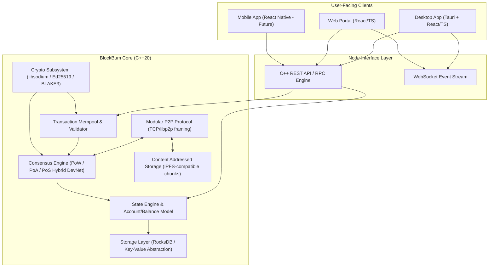

# BlockBum: Architecture & Phase-by-Phase Roadmap

## 1. System Overview & Vision

**BlockBum** is a decentralized, peer-to-peer community platform integrating messaging, content publishing/sharing, and a native cryptocurrency. It is designed ground-up with a high-performance **C++20** blockchain node core, modular P2P networking, content addressing (IPFS-compatible), and modern multi-platform clients (React + TypeScript + Tauri desktop, React Native mobile, Web).



---

## 2. Phased Roadmap

### Phase 1: Cryptographic Foundations & Data Model (Core Foundation)
* **Goal**: Establish the fundamental primitives, hashing, public-key signing, blocks, transactions, and verifiable chain state.
* **Key Components**:
  * Crypto layer: Ed25519 keypairs, signatures, BLAKE2b/BLAKE3 hashing (libsodium wrapper).
  * Data structures: `Transaction`, `BlockHeader`, `Block`, `MerkleTree`.
  * Binary & JSON serialization / deserialization.
  * Chain validation rules (previous hash linkage, merkle root integrity, signature verification).
* **Deliverable & Testing**: Unit test suite verifying key creation, transaction signing, block assembly, and tamper detection.

### Phase 2: State Engine & RocksDB Storage
* **Goal**: Transition from in-memory objects to a persistent, atomic blockchain database.
* **Key Components**:
  * Abstract Storage Interface (`IStorageEngine`).
  * RocksDB persistent implementation with an in-memory/file fallback for lightweight test environments.
  * World State (Account balances, nonces, UTXO or account state transitions).
  * Atomic block commit and rollback (reorganization support).
* **Deliverable & Testing**: Persistence tests, crash recovery test, state consistency validation.

### Phase 3: Mempool, Consensus & Block Production
* **Goal**: Enable standalone node execution that validates incoming transactions, queues them in a mempool, and mines/validates blocks.
* **Key Components**:
  * Mempool: Validation (nonce, balance, fee, replay protection), priority queue.
  * Configurable Consensus engine: Dynamic difficulty adjustment, configurable DevNet parameters.
  * Miner / Block Builder worker.
* **Deliverable & Testing**: Automated simulation producing transactions, mining valid blocks, updating ledger state.

### Phase 4: Modular P2P Networking Layer
* **Goal**: Inter-node communication over TCP with a framed, asynchronous protocol.
* **Key Components**:
  * Modular Transport Interface (`IPeerTransport`, `INetworkProtocol`).
  * Peer discovery & handshake (node identity exchange, protocol versioning).
  * Wire protocol: Ping/Pong, Block broadcast (`inv`, `getdata`, `block`), Transaction broadcast (`tx`).
  * Initial Block Download (IBD) sync protocol.
* **Deliverable & Testing**: Multi-node local network test where Node A mines blocks and Node B synchronizes seamlessly.

### Phase 5: REST API & RPC Server
* **Goal**: Expose an interface for clients and wallets to interact with the blockchain node.
* **Key Components**:
  * HTTP REST server in C++ (embedded lightweight server, e.g., Crow / cpp-httplib / Boost.Beast).
  * Endpoints:
    * `/api/v1/node/status`
    * `/api/v1/blocks/latest`, `/api/v1/blocks/:height_or_hash`
    * `/api/v1/tx/broadcast`
    * `/api/v1/account/:address`
  * Real-time WebSocket feed for new blocks and incoming transactions.
* **Deliverable & Testing**: CLI tool and integration tests interacting with the node via HTTP.

### Phase 6: Content Sharing & Decentralized Messaging Subsystem
* **Goal**: Bring the "BlockBum Community Platform" features into the protocol.
* **Key Components**:
  * Content addressing (chunking data, CID generation, IPFS compatibility bridge).
  * On-chain metadata & off-chain payload storage.
  * End-to-end encrypted messaging transactions (ECDH key exchange via libsodium).
  * Social/community feed primitives (posts, channels, tip transactions).
* **Deliverable & Testing**: End-to-end messaging test between two identities.

### Phase 7: Desktop Application (Tauri + React + TypeScript)
* **Goal**: Polished, cross-platform UI for users to manage wallets, send transactions, chat, and share content.
* **Key Components**:
  * Embedded or remote node connector.
  * Wallet management (mnemonic generation, encrypted keystore, send/receive).
  * Community feed & decentralized messaging UI.
* **Deliverable & Testing**: Runnable desktop application packaged with Tauri.

---

## 3. Recommended Repository Layout

```
BlockBum/
├── CMakeLists.txt                 # Root CMake configuration (C++20)
├── cmake/                         # CMake modules, CPM or FetchContent helpers
├── docs/                          # Architecture & protocol specifications
│   ├── ARCHITECTURE.md
│   ├── PROTOCOL.md
│   └── API.md
├── src/
│   ├── core/                      # Types, hashing, crypto, data structures
│   ├── consensus/                 # Consensus rules & block production
│   ├── storage/                   # Storage engine abstraction & RocksDB impl
│   ├── network/                   # P2P connection management & wire protocol
│   ├── rpc/                       # HTTP REST & WebSocket API server
│   └── node/                      # Node daemon executable entry point
├── tests/
│   ├── unit/                      # GoogleTest unit tests
│   └── integration/               # Multi-node integration tests
├── client/
│   ├── desktop/                   # Tauri + React + TypeScript desktop client
│   └── web/                       # React web dashboard
└── scripts/
    ├── devnet-up.sh               # Spin up local multi-node network
    └── build.sh                   # Standardized build script
```
