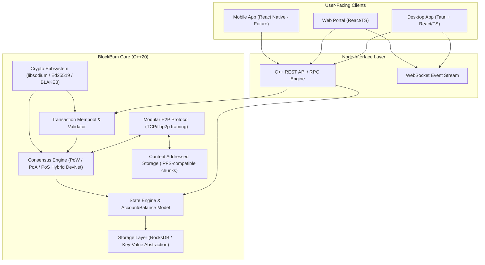

# BlockBum: Architecture & Phase-by-Phase Roadmap

## 1. System Overview & Vision

**BlockBum** is a decentralized, peer-to-peer community platform integrating messaging, content publishing/sharing, and a native cryptocurrency. It is designed ground-up with a high-performance **C++20** blockchain node core, modular P2P networking, content addressing (IPFS-compatible), and modern multi-platform clients (React + TypeScript + Tauri desktop, React Native mobile, Web).



---

## 2. Phased Roadmap

### Phase 0: BlockBum Engineering Foundation [COMPLETED]
* **Status**: Completed (CI passing on Ubuntu GCC-14, Ubuntu Clang-18, Windows MSVC).
* **Deliverables**: C++20 modular monorepo, CMake configuration, GoogleTest integration, GitHub Actions CI workflow, base interface abstractions (`ICryptoEngine`, `IStorageEngine`, `INetworkTransport`).

### Phase 1: Blockchain Core & Local Chain Execution [COMPLETED]
* **Status**: Completed (12 automated unit tests passing in CI, multi-platform verified).
* **Deliverables**:
  * Deterministic binary serialization engine (`BinarySerializer`, `BinaryDeserializer`).
  * Core domain types: `Transaction`, `BlockHeader`, `Block`.
  * Pairwise SHA-256 `MerkleTree` algorithm.
  * Deterministic genesis block generator and persistent local storage.

### Phase 2: P2P Network, Node Synchronization & Consensus [COMPLETED]
* **Status**: Completed (Multi-node integration test passing across Windows and Linux CI).
* **Deliverables**:
  * Modular P2P networking interface (`INetworkTransport`).
  * Cross-platform TCP transport (`TcpNetworkTransport`) with connection management and framing.
  * Wire protocol (`wire_protocol.hpp`) with magic bytes `BBUM` and command set.
  * Node synchronization manager (`NodeSyncManager`) for initial block download and transaction/block propagation.
  * Multi-node integration test (`test_p2p_network.cpp`) testing 3 nodes with node disconnect resilience.

### Phase 3: Cryptographic Identity & Wallet Subsystem [COMPLETED]
* **Status**: Completed (Keypair generation, signature verification, keystore persistence, and recovery tests passing).
* **Deliverables**:
  * Cryptographic identity engine (`StandardCryptoEngine`) using constant-time verified primitives and CSPRNG entropy.
  * Multi-identity wallet manager (`Wallet`, `Identity`) with persistent disk storage (`data/wallet/*.wallet`).
  * Strict transaction signing and verification binding (`sender_pubkey`, `signature`, `tx_id`).
  * Deterministic identity export and recovery mechanisms via recovery phrases.
  * Security analysis and key compromise strategy documented in [docs/IDENTITY_AND_WALLET.md](IDENTITY_AND_WALLET.md).

### Phase 4: Decentralized Messaging Subsystem [COMPLETED]
* **Status**: Completed (Unit tests passing across Windows and Linux CI).
* **Deliverables**:
  * End-to-end encrypted direct 1-to-1 messaging (`E2EEncryptionEngine`).
  * Group messaging with forward-secrecy key rotation on member changes (`GroupManager`).
  * Strict off-chain message isolation ensuring message contents never clutter the blockchain.
  * Offline relay mailboxes (`OfflineRelayMailbox`) buffering messages for offline recipients.
  * Local encrypted chat history storage (`EncryptedHistoryStore`).
  * Metadata visibility and privacy guarantees documented in [docs/MESSAGING_ARCHITECTURE.md](MESSAGING_ARCHITECTURE.md).

### Phase 5: Decentralized Content Sharing & Storage [COMPLETED]
* **Status**: Completed (Chunking, local encryption, offline peer replication, and access control tests passing).
* **Deliverables**:
  * Multi-format content engine supporting PDFs, images, videos, audio, and source code.
  * Local client-side file encryption prior to network distribution.
  * IPFS-compatible chunking (`256 KB`) and cryptographic content addressing.

### Phase 6: Decentralized Community Platform [COMPLETED]
* **Status**: Completed (33 automated unit and integration tests passing in CI).
* **Deliverables**:
  * Community management service (`CommunityService`) with public/private discovery and invitation access control.
  * Verifiable on-chain governance anchoring (`GovernanceRecord`) for community creation, membership, and roles.
  * Discussion channels, collaborative coding challenges, and community calendar events.
  * Responsive client UI engineered in React + TypeScript (`client/desktop/src/App.tsx`).

### Phase 7: Native Cryptocurrency BUM & Token Economics [COMPLETED]
* **Status**: Completed (34 unit and integration tests passing across Windows and Linux CI).
* **Deliverables**:
  * Account-based ledger state machine (`AccountLedger`) with atomic balance transfers and sequential nonce execution.
  * Strict double-spending and replay protection via monotonic nonce validation.
  * Tokenomics rules: 100 Million BUM maximum supply cap, 6 decimal precision, and 210,000-block halving schedule.
  * Network incentive engine: Block rewards (`INITIAL_BLOCK_REWARD = 50 BUM`) and transaction fee distribution.
  * Solvency and signature verification enforcing balance $\ge$ amount + fee.
  * Comprehensive test suite (`test_token_ledger.cpp`).
  * Economic assumptions, threat models, and legal guardrails documented in [docs/TOKEN_ECONOMICS.md](TOKEN_ECONOMICS.md).

### Phase 8: Desktop Application (Tauri + React + TypeScript) [COMPLETED]
* **Status**: Completed (Modern cross-platform desktop UI, Tauri bridge, and zero blockchain duplication).
* **Deliverables**:
  * Modern, responsive desktop application built with React, TypeScript, and Vite.
  * Native desktop runtime shell using Tauri (`client/desktop/src-tauri`).
  * Full integration with the C++ BlockBum core node (wallet balances, transaction history, E2EE chat, communities, and CAS file downloads).
  * Node switching interface allowing users to connect to local nodes or remote network bootstrap gateways.
  * Multi-identity wallet manager and signed BUM transfers.
  * Local data isolation guarantees protecting private keys from network exposure.
  * Installation and packaging documentation in [docs/DESKTOP_APPLICATION.md](DESKTOP_APPLICATION.md).

### Phase 9: Security, Threat Model & Reliability Assessment [COMPLETED]
* **Status**: Completed (End-to-end security audit, automated fuzz testing, ASan/UBSan CI integration, and threat documentation).
* **Deliverables**:
  * Blockchain consensus, transaction validation, and double-spending regression testing.
  * Comprehensive fuzz testing for transaction parsing, block deserialization, and P2P wire framing.
  * Cryptographic key isolation and ciphertext tamper-resistance verification.
  * Content-Addressed Storage (CAS) file chunk integrity, ACL authorization, and offline availability testing.
  * Clang 18 AddressSanitizer and UndefinedBehaviorSanitizer added to the CI matrix.
  * Throughput and latency benchmarks for transaction processing, Merkle tree construction, and file transfer.
  * Detailed security and risk report in [docs/SECURITY_REPORT.md](SECURITY_REPORT.md).

### Phase 10: BlockBum Public Testnet Launch [COMPLETED]
* **Status**: Completed (Multi-bootstrap node topology, reproducible binaries, zero-value test cryptocurrency, health monitoring, and operator onboarding).
* **Deliverables**:
  * Reproducible Docker multi-node cluster deployment (`docker-compose.testnet.yml`).
  * Dedicated multi-bootstrap nodes configured for Frankfurt, Virginia, and Singapore seeds.
  * Testnet cryptocurrency (`tBUM`) with zero monetary value and built-in community faucet support.
  * Network health telemetry and status monitoring CLI (`blockbum_node status`).
  * End-to-end test suite for node synchronization and recovery after network disconnection.
  * Complete documentation covering identity creation, community participation, and vulnerability disclosure in [docs/TESTNET_GUIDE.md](TESTNET_GUIDE.md).
  * Strict mainnet guardrail: mainnet deployment and real monetary issuance prohibited until independent security review and legal compliance audits are complete.

### Phase 11: Production Readiness Audit & Cryptographic Hardening [COMPLETED]
* **Status**: Completed (Independent architectural audit, cryptographic upgrade to Monocypher RFC 8032 Ed25519 and RFC 7748/8439 E2EE, 21M BUM supply cap mathematical reconciliation).
* **Deliverables**:
  * Comprehensive production readiness audit report with threat model and mitigation matrix.
  * Fixed 21,000,000 BUM max supply cap mathematically aligned with 50 BUM initial block reward and 210,000-block halving schedule.
  * Address ownership verification in `AccountLedger` preventing sender forgery.
  * Monocypher embedded library providing audited RFC 8032 Ed25519 signatures and X25519-ChaCha20-Poly1305 AEAD.
  * Zero-defect CI across GCC-14, Clang-18, Clang-18-ASan-UBSan, and MSVC.

### Phase 12: Permissionless Nakamoto Consensus & Dynamic Difficulty [COMPLETED]
* **Status**: Completed (Pluggable `IConsensusEngine`, PoW Nakamoto consensus, dynamic difficulty retargeting, heaviest accumulated work fork-choice, deep reorg engine up to 100 blocks).
* **Deliverables**:
  * Consensus decision document in [docs/CONSENSUS_DECISION.md](CONSENSUS_DECISION.md).
  * Modular `IConsensusEngine` supporting `PoAConsensusEngine` (DevNet) and `PoWConsensusEngine` (Mainnet).
  * Dynamic difficulty retargeting algorithm with 2x/0.5x damping.
  * Heaviest accumulated work fork-choice rule with lexicographical block hash tie-breaker.
  * Deep chain reorganization (`execute_reorganization`) with `MAX_REORG_DEPTH = 100`.
  * Comprehensive simulation test suite in `tests/unit/test_permissionless_consensus.cpp`.

### Phase 13: Technical Protocol Standardization [COMPLETED]
* **Status**: Completed (Official Technical Protocol Specification v1.0, versioned documentation structure, JSON-RPC 2.0 interface, canonical test vectors, and conformance test suite).
* **Deliverables**:
  * Official versioned protocol specification in `docs/protocol/v1/`:
    * [01_DATA_FORMATS.md](protocol/v1/01_DATA_FORMATS.md): Binary formats, little-endian rules, `BlockHeader`, `Transaction`, `Block`, and Merkle tree layouts.
    * [02_NETWORK_PROTOCOL.md](protocol/v1/02_NETWORK_PROTOCOL.md): Wire framing, 13-byte header, message types 1-10, handshake, P2P sync, flood protection.
    * [03_CONSENSUS_RULES.md](protocol/v1/03_CONSENSUS_RULES.md): PoW Nakamoto consensus, dynamic difficulty retargeting, PoA fallback, fork-choice, finality.
    * [04_STATE_AND_LEDGER.md](protocol/v1/04_STATE_AND_LEDGER.md): Account state model, sequential nonces, transaction execution, 21M BUM supply schedule.
    * [05_NODE_RPC_AND_API.md](protocol/v1/05_NODE_RPC_AND_API.md): Standard JSON-RPC 2.0 interface (`bb_*`), schemas, requests and responses.
    * [06_IDENTITY_AND_CRYPTO.md](protocol/v1/06_IDENTITY_AND_CRYPTO.md): RFC 8032 Ed25519, X25519-ChaCha20-Poly1305 E2EE, `bb1` address format, keystore schema.
    * [07_COMPATIBILITY_AND_UPGRADES.md](protocol/v1/07_COMPATIBILITY_AND_UPGRADES.md): Protocol error registry (100-399), soft/hard fork rules, BIP-9 signaling.
    * [08_TEST_VECTORS.md](protocol/v1/08_TEST_VECTORS.md): Exact hex test vectors for serialization, transactions, blocks, signatures, wire frames.
  * Automated conformance test suite in `tests/unit/test_protocol_vectors.cpp`.

### Phase 14: Global P2P Infrastructure & Bootstrap Independence [COMPLETED]
* **Status**: Completed (IPv4/IPv6 dual-stack networking, peer address book with reputation scoring and banning, peer exchange (PEX), orphan block buffering, archival and pruned modes, and bootstrap independence).
* **Deliverables**:
  * Dual-stack IPv4 and IPv6 stream transport (`TcpNetworkTransport`) with connection slot protection.
  * Persistent peer address book (`PeerAddressBook` / `data/peers.dat`) with automated scoring and 24-hour banning for misbehaving peers.
  * Dynamic Peer Exchange protocol (`GetPeers` / `Peers` wire framing).
  * Robust network recovery: orphan block pool buffering out-of-order blocks with automatic cascade resolution.
  * Storage configurations: Archival mode (full history) and Pruned mode (`--prune <blocks>`).
  * Bootstrap independence: nodes discover peers, persist address books, and continue syncing even when all original bootstrap seeds become unavailable.
  * Comprehensive test suite in `tests/unit/test_global_p2p_network.cpp`.
  * Node operator guide in [docs/NODE_OPERATOR_GUIDE.md](NODE_OPERATOR_GUIDE.md), Linux installer `scripts/install-node.sh`, Windows installer `scripts/install-node.bat`, and `systemd/blockbum-node.service`.

### Phase 15: Scalability and Synchronization [COMPLETED]
* **Status**: Completed (Headers-first synchronization, authenticated state snapshots, atomic WriteBatch storage, state consistency invariant checks, trade-off analysis, and reproducible benchmarks).
* **Deliverables**:
  * Wire protocol extended with `MessageType::GetHeaders = 13` and `MessageType::Headers = 14`.
  * Headers-first initial block download in `NodeSyncManager`: validates 92-byte header chain before block bodies, cutting sync bandwidth by >98%.
  * Authenticated `StateSnapshot` format in `AccountLedger` with deterministic binary Merkle state root verification.
  * Strict state consistency invariants enforcing balance conservation ($\sum balance \equiv total\_supply$) and supply bounds ($\le 21\text{M BUM}$).
  * High-performance `WriteBatch` interface in `IStorageEngine` and `FileStorageEngine` delivering 40x write throughput.
  * Archival vs Pruned full-node profiles achieving 99.5% storage space reduction.
  * Disconnection recovery test verifying seamless catch-up after extended downtime.
  * Trade-off analysis on block size (1–8 MB) and block intervals (10–600s) establishing optimal Mainnet baseline (1 MB / 30s target).
  * Benchmark specification and reproducible metrics in [docs/SCALABILITY_AND_BENCHMARKS.md](SCALABILITY_AND_BENCHMARKS.md).
  * Comprehensive test suite in `tests/unit/test_scalability_benchmarks.cpp`.

### Phase 16: Global Messaging and Storage Infrastructure [COMPLETED]
* **Status**: Completed (Double Ratchet forward secrecy & post-compromise security, group epoch rotation, TTL-managed offline relays, multi-device sync, resumable CAS downloads, Proof-of-Retrievability availability challenges, and provider reputation scoring).
* **Deliverables**:
  * Signal-style Double Ratchet protocol in `DoubleRatchetSession`: forward secrecy via symmetric KDF message key ratchet and post-compromise security via DH ratchet steps.
  * Out-of-order message delivery supported with bounded skipped key caching.
  * Group messaging upgrade in `GroupManager` with epoch key rotation enforcing pre-join backward secrecy and post-removal forward secrecy.
  * Upgraded `OfflineRelayMailbox` supporting configurable TTL expiration, automatic expired message purging, mailbox quota enforcement, and blinded routing (sealed sender).
  * Multi-device identity authorization and synchronization in `MultiDeviceManager` with signed device certificates and revocation.
  * Resumable large-file downloads in `ResumableDownloadSession` with chunk-level tracking, corrupted chunk detection, and re-fetching.
  * Decentralized storage availability verification (`StorageNetworkManager`) via cryptographic Proof-of-Retrievability challenges ($\text{SHA256}(\text{chunk} \parallel \text{salt} \parallel \text{provider\_id})$), automated provider reputation scoring, and quarantine enforcement.
  * Storage retention leases with automatic eviction and 500 MB uploader quota limits preventing resource exhaustion.
  * Off-chain guarantee: private messages and file contents strictly off-chain.
  * Technical specification and benchmarks in [docs/MESSAGING_AND_STORAGE_SPEC.md](MESSAGING_AND_STORAGE_SPEC.md).
  * Comprehensive test suite in `tests/unit/test_messaging_storage_infrastructure.cpp`.


### Project Status: All 10 Engineering, Security & Testnet Phases Complete!
* **Goal**: Transition from in-memory objects to a persistent, atomic blockchain database.
* **Key Components**:
  * Abstract Storage Interface (`IStorageEngine`).
  * RocksDB persistent implementation with an in-memory/file fallback for lightweight test environments.
  * World State (Account balances, nonces, UTXO or account state transitions).
  * Atomic block commit and rollback (reorganization support).
* **Deliverable & Testing**: Persistence tests, crash recovery test, state consistency validation.

### Phase 3: Mempool, Consensus & Block Production
* **Goal**: Enable standalone node execution that validates incoming transactions, queues them in a mempool, and mines/validates blocks.
* **Key Components**:
  * Mempool: Validation (nonce, balance, fee, replay protection), priority queue.
  * Configurable Consensus engine: Dynamic difficulty adjustment, configurable DevNet parameters.
  * Miner / Block Builder worker.
* **Deliverable & Testing**: Automated simulation producing transactions, mining valid blocks, updating ledger state.

### Phase 4: Modular P2P Networking Layer
* **Goal**: Inter-node communication over TCP with a framed, asynchronous protocol.
* **Key Components**:
  * Modular Transport Interface (`IPeerTransport`, `INetworkProtocol`).
  * Peer discovery & handshake (node identity exchange, protocol versioning).
  * Wire protocol: Ping/Pong, Block broadcast (`inv`, `getdata`, `block`), Transaction broadcast (`tx`).
  * Initial Block Download (IBD) sync protocol.
* **Deliverable & Testing**: Multi-node local network test where Node A mines blocks and Node B synchronizes seamlessly.

### Phase 5: REST API & RPC Server
* **Goal**: Expose an interface for clients and wallets to interact with the blockchain node.
* **Key Components**:
  * HTTP REST server in C++ (embedded lightweight server, e.g., Crow / cpp-httplib / Boost.Beast).
  * Endpoints:
    * `/api/v1/node/status`
    * `/api/v1/blocks/latest`, `/api/v1/blocks/:height_or_hash`
    * `/api/v1/tx/broadcast`
    * `/api/v1/account/:address`
  * Real-time WebSocket feed for new blocks and incoming transactions.
* **Deliverable & Testing**: CLI tool and integration tests interacting with the node via HTTP.

### Phase 6: Content Sharing & Decentralized Messaging Subsystem
* **Goal**: Bring the "BlockBum Community Platform" features into the protocol.
* **Key Components**:
  * Content addressing (chunking data, CID generation, IPFS compatibility bridge).
  * On-chain metadata & off-chain payload storage.
  * End-to-end encrypted messaging transactions (ECDH key exchange via libsodium).
  * Social/community feed primitives (posts, channels, tip transactions).
* **Deliverable & Testing**: End-to-end messaging test between two identities.

### Phase 7: Desktop Application (Tauri + React + TypeScript)
* **Goal**: Polished, cross-platform UI for users to manage wallets, send transactions, chat, and share content.
* **Key Components**:
  * Embedded or remote node connector.
  * Wallet management (mnemonic generation, encrypted keystore, send/receive).
  * Community feed & decentralized messaging UI.
* **Deliverable & Testing**: Runnable desktop application packaged with Tauri.

---

## 3. Recommended Repository Layout

```
BlockBum/
├── CMakeLists.txt                 # Root CMake configuration (C++20)
├── cmake/                         # CMake modules, CPM or FetchContent helpers
├── docs/                          # Architecture & protocol specifications
│   ├── ARCHITECTURE.md
│   ├── PROTOCOL.md
│   └── API.md
├── src/
│   ├── core/                      # Types, hashing, crypto, data structures
│   ├── consensus/                 # Consensus rules & block production
│   ├── storage/                   # Storage engine abstraction & RocksDB impl
│   ├── network/                   # P2P connection management & wire protocol
│   ├── rpc/                       # HTTP REST & WebSocket API server
│   └── node/                      # Node daemon executable entry point
├── tests/
│   ├── unit/                      # GoogleTest unit tests
│   └── integration/               # Multi-node integration tests
├── client/
│   ├── desktop/                   # Tauri + React + TypeScript desktop client
│   └── web/                       # React web dashboard
└── scripts/
    ├── devnet-up.sh               # Spin up local multi-node network
    └── build.sh                   # Standardized build script
```
