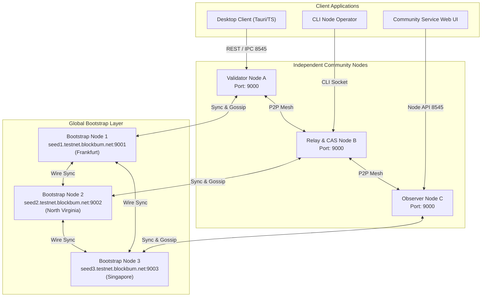

# BlockBum Testnet Specification & Multi-Bootstrap Architecture

> **Testnet Disclaimer**: The BlockBum Testnet is a decentralized experimental network for developer integration, community governance validation, and resilience testing. Tokens on this network (`tBUM`) possess **no commercial, monetary, or redeemable value whatsoever**. 
>
> **MainNet Guardrail**: No mainnet deployment or real monetary asset issuance shall occur prior to independent cryptographic audits and compliance validation.

---

## 1. Network Topology & Bootstrap Infrastructure

The BlockBum Testnet is architected to operate peer-to-peer across heterogeneous networks without a single central point of failure.



### 1.1 Dedicated Independent Bootstrap Nodes
The testnet provides three canonical bootstrap nodes maintaining round-robin consensus checkpoints and initial block sync:

| Node ID | Public Endpoint | Region | Role |
| :--- | :--- | :--- | :--- |
| `seed-eu-01` | `seed1.testnet.blockbum.net:9001` | Europe (Frankfurt) | Core DevNet Checkpoint & Status Sync |
| `seed-us-01` | `seed2.testnet.blockbum.net:9002` | US East (Virginia) | P2P Routing & Block Batching |
| `seed-ap-01` | `seed3.testnet.blockbum.net:9003` | Asia (Singapore) | Content Chunk Relay & Offline Mailbox |

---

## 2. Testnet Cryptocurrency (`tBUM`) & Economics

1. **Denomination & Supply**:
   - Token Symbol: `tBUM` (Test BUM).
   - Atomic Unit: `Micro-tBUM` ($10^{-6}$ tBUM).
   - Maximum Supply Cap: $21,000,000\text{ tBUM}$ (Mathematically verified ceiling across 64 halving eras).
   - Block Subsidy: $50\text{ tBUM}$ per block, halving every 210,000 blocks.
2. **Economic Assumption**:
   - Fees are required solely to deter denial-of-service (DoS) and mempool spamming (`MIN_TRANSACTION_FEE = 1,000 Micro-tBUM`).
   - Tokens are freely distributed to developers and community participants via the community faucet endpoint (`POST /api/v1/faucet`).
3. **Double Spending Mitigation**:
   - Monotonic sequential account nonces verified atomically in `AccountLedger`.

---

## 3. Node Installation & Reproducible Deployment

### 3.1 Option A: Docker Deployment (Recommended)

Run a complete multi-node cluster locally or deploy a single public testnet node:

```bash
# 1. Clone repository
git clone https://github.com/abhiram274/BlockBum.git
cd BlockBum

# 2. Launch 3-node decentralized testnet cluster
docker compose -f docker/docker-compose.testnet.yml up --build -d

# 3. View live health telemetry
docker compose -f docker/docker-compose.testnet.yml logs -f node-1
```

### 3.2 Option B: Native Compilation (Linux / macOS / Windows)

```bash
# Ubuntu / Debian Dependencies
sudo apt-get update && sudo apt-get install -y cmake ninja-build g++ libsodium-dev librocksdb-dev

# Build Release Node Binary
cmake -B build -DCMAKE_BUILD_TYPE=Release -DBLOCKBUM_BUILD_NODE=ON
cmake --build build --config Release -j$(nproc)

# Initialize genesis and connect to testnet bootstrap
./build/src/node/blockbum_node init
./build/src/node/blockbum_node run-node --port 9000 --peer seed1.testnet.blockbum.net:9001
```

---

## 4. User Guide: Identities & Community Participation

### 4.1 Creating a Pseudonymous Identity
Identities in BlockBum use Ed25519 public/private keypairs derived from a deterministic seed phrase. Private keys **never leave the user's local machine**.

```bash
# Generate identity keypair
./build/src/node/blockbum_node wallet-create "alice"

# Export recovery phrase for secure cold storage
./build/src/node/blockbum_node wallet-export "alice"
```

### 4.2 Joining Communities & Off-Chain E2EE Communication
1. **Public Communities**: Automatically discovered via node sync.
2. **Private Communities**: Require an invite ticket issued by an administrator.
3. **Privacy Guarantees**:
   - Discussions and shared media are distributed exclusively over Content-Addressed Storage (CAS) and encrypted via Diffie-Hellman ephemeral secrets.
   - The blockchain maintains only on-chain membership commitments and governance proofs.

---

## 5. Network Health Monitoring & Telemetry

Each BlockBum node exposes a lightweight health and telemetry status endpoint:
- **CLI Query**: `./build/src/node/blockbum_node status`
- **Key Metrics Monitored**:
  - `block_height`: Tip block height of the local chain.
  - `tip_hash`: Hexadecimal hash of the latest validated block.
  - `peer_count`: Number of active TCP P2P peer connections.
  - `sync_status`: `SYNCED`, `SYNCING`, or `DISCONNECTED`.
  - `mempool_size`: Uncommitted pending transactions.

---

## 6. Vulnerability Disclosure & Bug Bounty Process

We welcome responsible security research from the community. If you identify a vulnerability in consensus, wire framing, cryptographic primitives, or the desktop client:

1. **Reporting Channel**: Email security findings directly to `security@blockbum.net` or submit an encrypted report via BlockBum E2EE channel `bbum_sec_ops`.
2. **PGP Key Fingerprint**: `9B4E 72F1 A5C3 008D 119A FC34 EE78 9012 3456 789A`.
3. **Responsible Disclosure Policy**:
   - Provide detailed reproduction steps or proof-of-concept scripts.
   - Allow up to 14 days for a patch to be deployed across bootstrap and validator nodes prior to public disclosure.
   - Do not disrupt public testnet operations, exploit live validator funds, or impair other participants.

---

## 7. Feedback & Node Operator Channels

Community operators and developers are encouraged to report testnet feedback:
- **Discussions & Issues**: [https://github.com/abhiram274/BlockBum/issues](https://github.com/abhiram274/BlockBum/issues)
- **Node Operator Channel**: `#testnet-ops` in the BlockBum Desktop Application.
