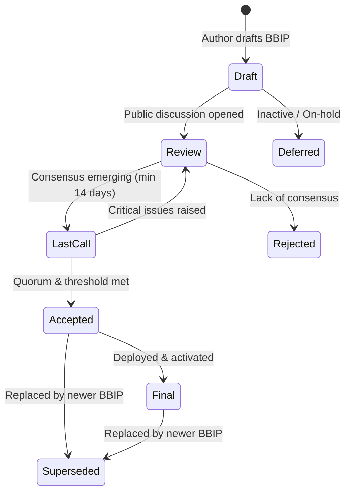

# BBIP-0001: BlockBum Improvement Proposal (BBIP) Guidelines and Workflow

```
BBIP: 0001
Title: BlockBum Improvement Proposal (BBIP) Guidelines and Workflow
Author: BlockBum Core Protocol Contributors <dev@blockbum.net>
Status: Active
Type: Process
Created: 2026-11-20
```

---

## 1. Abstract
A BlockBum Improvement Proposal (BBIP) is a formal design document providing information to the BlockBum community, or describing a new feature, process, or consensus rule change for the BlockBum blockchain and decentralized communication protocol.

This document specifies the purpose, taxonomy, workflow, review standards, and decision mechanics of the BBIP process.

---

## 2. BBIP Taxonomy & Categories

A BBIP falls into one of three primary tracks:

### 2.1 Standards Track
Standards Track proposals describe changes that affect interoperability, network protocols, transaction formats, cryptographic standards, or state transitions. Standards Track BBIPs are subdivided into:

1. **Core**: Changes to consensus validation rules, block production algorithms, issuance mechanics, state transitions, and halving parameters.
2. **Consensus**: Modifications to fork-choice weights, proof systems, validator rotation, or finality proofs.
3. **Networking**: P2P transport framing, peer discovery, message serialization, and wire gossip protocols.
4. **Interface / RPC**: Node JSON-RPC, WebSocket streaming, and client wallet interfaces.
5. **Storage & Content**: Content-addressable storage (CAS) chunking, Proof-of-Retrievability (PoR) protocols, and replication leases.

### 2.2 Informational Track
Informational proposals describe a design issue, provide general guidelines, or inform the ecosystem on community best practices without proposing a protocol change.

### 2.3 Process / Meta Track
Process proposals describe or suggest changes to governance processes, improvement proposal workflows, decision procedures, or maintainer guidelines.

---

## 3. BBIP Lifecycle and State Transitions



1. **Draft**: Initial proposal written following the standard BBIP template, hosted in the `docs/bips/` directory.
2. **Review**: The proposal is published for community and core developer review on the BlockBum community forum and repository discussions.
3. **Last Call**: A minimum 14-day formal review window prior to final acceptance.
4. **Accepted**: Standards Track proposal approved by relevant stakeholder consensus or on-chain governance quorum.
5. **Final**: Code implementation merged, tested, and activated on public testnet and/or mainnet.
6. **Rejected**: Proposal failed to achieve consensus, exhibited security flaws, or violated protocol invariants.
7. **Superseded**: A previously Final BBIP has been made obsolete by a newer approved proposal.

---

## 4. BBIP Template Structure

Every proposal must follow the standard structure:
- **Preamble**: RFC 822-style header metadata (`BBIP`, `Title`, `Author`, `Status`, `Type`, `Category`, `Created`, `Requires`).
- **Abstract**: Short technical summary (< 200 words).
- **Motivation**: Clear explanation of the problem solved.
- **Specification**: Exhaustive technical documentation, syntax, binary formats, and algorithms.
- **Rationale**: Design trade-offs, alternative approaches considered, and rejection justifications.
- **Backwards Compatibility**: Soft fork vs hard fork analysis; migration paths.
- **Reference Implementation**: Working code, pull request, or test vectors.
- **Security Considerations**: Cryptographic threat model, DoS attack vectors, economic incentives, and failure modes.

---

## 5. Protocol Upgrade & Activation Procedures

### 5.1 Soft Forks (Backward-Compatible)
A soft fork tightens validation rules such that old nodes accept blocks produced by new nodes:
- **Signaling**: Proposers set a version bit in `BlockHeader.version`.
- **Threshold**: Requires $\ge 90\%$ of blocks over a difficulty/epoch window (e.g. 2,016 blocks) to signal readiness.
- **Grace Period**: A 14-day activation delay following threshold achievement before new rules are enforced.

### 5.2 Hard Forks (Backward-Incompatible)
A hard fork loosens or redefines validation rules such that old nodes will reject new blocks:
- **Prerequisite**: Broad ecosystem rough consensus among developers, node operators, validators, exchanges, and users.
- **Flag Day Activation**: Activation scheduled at a specific deterministic block height $H_{\text{activation}}$.
- **Node Upgrades**: Node operators must upgrade software before $H_{\text{activation}}$. Un-upgraded nodes will split onto a minority branch.

---

## 6. Anti-Centralization & Inviolate Invariants

To protect BlockBum from administrative capture or central governance tyranny, all proposals are subject to immutable protocol boundaries:

1. **Inviolate Private Property**: No BBIP or governance vote can ever seize, confiscate, or alter private user balances. Any block containing such state manipulation is unconditionally rejected by validating nodes.
2. **Deterministic Cryptographic Enforcement**: All monetary transfers must be cryptographically signed by the legitimate keyholder. Nonce replay protection and signature verification cannot be bypassed.
3. **No Unilateral Control**: No single developer, foundation, or validator coalition possesses administrative backdoors, master keys, or veto authority.
