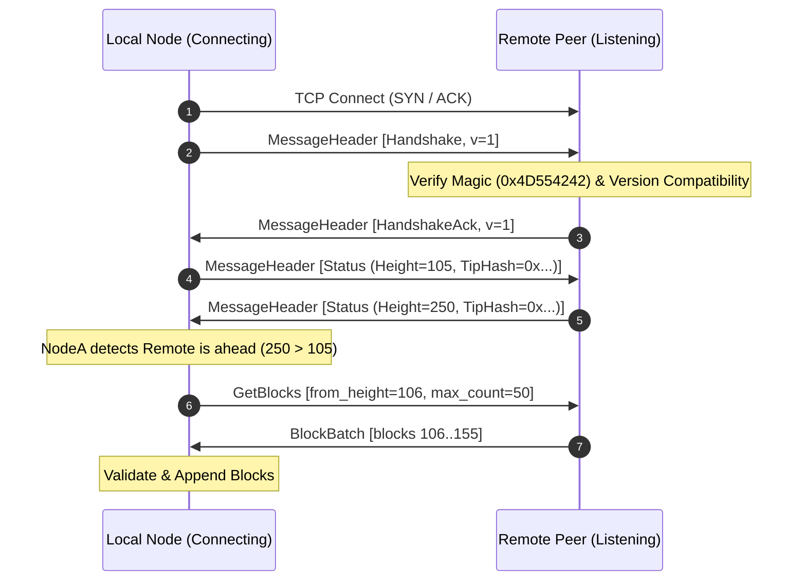

# BlockBum Protocol Specification — Chapter 02: Network Wire Protocol & P2P Synchronization

**Protocol Version:** 1.0  
**Specification Document:** BB-SPEC-02  
**Status:** Normative  

---

## 1. Network Transport & Framing Architecture

BlockBum nodes communicate over reliable stream transports (TCP/IP). All communications utilize a framed binary packet protocol with fixed-length message headers to ensure streaming safety, framing synchronization, and denial-of-service resilience.

### 1.1 Wire Header Specification

Every message transmitted over the BlockBum network MUST begin with a 13-byte fixed header:

```
+-------------------------------------------------------------------------+
|                        BlockBum Wire Message Header                     |
+-------------------+-------------+--------+------------------------------+
| Field Name        | Type        | Offset | Description                  |
+-------------------+-------------+--------+------------------------------+
| magic             | uint32_t    | 0      | Protocol magic identifier    |
| version           | uint32_t    | 4      | Protocol wire version        |
| type              | uint8_t     | 8      | Message type identifier      |
| payload_size      | uint32_t    | 9      | Size of trailing payload (B) |
+-------------------+-------------+--------+------------------------------+
```

### 1.2 Header Constants & Constraints

1. **Magic Identifier (`magic`):**  
   MUST equal `0x4D554242` (the ASCII characters `"BBUM"` in Little-Endian byte order: `0x42 0x42 0x55 0x4D`). If a node receives a stream segment with mismatched magic bytes, it MUST immediately terminate the TCP connection.
2. **Protocol Version (`version`):**  
   MUST indicate the wire protocol version (currently `1`).
3. **Payload Size (`payload_size`):**  
   Defines the exact byte count of the payload immediately following the 13-byte header.
4. **Maximum Message Size (`MAX_MESSAGE_SIZE`):**  
   The maximum permitted `payload_size` is **10,485,760 bytes** (10 MiB). Any frame declaring a `payload_size > MAX_MESSAGE_SIZE` MUST be rejected, and the peer MUST be disconnected to prevent heap exhaustion attacks.

---

## 2. Message Types Catalog

BlockBum defines 10 core wire message types identified by the 1-byte `type` field:

| Type ID | Enum Name | Direction | Payload Structure | Purpose |
| :---: | :--- | :--- | :--- | :--- |
| `0x01` | `Ping` | Bidirectional | Optional Timestamp / Nonce | Keepalive heartbeat ping. |
| `0x02` | `Pong` | Bidirectional | Mirrors Ping payload | Keepalive response. |
| `0x03` | `Handshake` | Outbound $\to$ Inbound | `HandshakePayload` | Initial peer connection greeting. |
| `0x04` | `HandshakeAck` | Inbound $\to$ Outbound | `HandshakeAckPayload` | Handshake acceptance and node identity. |
| `0x05` | `GetStatus` | Bidirectional | None (0 bytes) | Requests peer blockchain status. |
| `0x06` | `Status` | Bidirectional | `StatusPayload` | Announces current tip height and hash. |
| `0x07` | `GetBlocks` | Bidirectional | `GetBlocksPayload` | Requests sequential block range. |
| `0x08` | `BlockBatch` | Bidirectional | `BlockBatchPayload` | Returns batch of requested blocks. |
| `0x09` | `NewBlock` | Broadcast | Serialized `Block` | Propagates newly mined/verified block. |
| `0x0A` | `NewTransaction`| Broadcast | Serialized `Transaction` | Propagates newly received unconfirmed tx. |
| `0x0B` | `GetPeers` | Bidirectional | `GetPeersPayload` | Query known peer addresses for PEX discovery. |
| `0x0C` | `Peers` | Bidirectional | `PeersPayload` | Returns list of active peers with timestamps. |

---

## 3. Message Payload Definitions

### 3.1 StatusPayload (`0x06`)
Announces the current state of a node's active blockchain branch.

```
+--------------------+--------------+-------------------------------------+
| Field Name         | Type         | Description                         |
+--------------------+--------------+-------------------------------------+
| height             | uint64_t     | Current active tip height (LE)      |
| tip_hash           | Hash256      | 32-byte SHA-256 active tip hash     |
| node_id            | string       | 4B length + UTF-8 node identifier  |
+--------------------+--------------+-------------------------------------+
```

### 3.2 GetBlocksPayload (`0x07`)
Requests a consecutive batch of blocks beginning at `from_height`.

```
+--------------------+--------------+-------------------------------------+
| Field Name         | Type         | Description                         |
+--------------------+--------------+-------------------------------------+
| from_height        | uint64_t     | Starting block height to fetch (LE) |
| max_count          | uint32_t     | Maximum blocks to return (default 50)
+--------------------+--------------+-------------------------------------+
```
*Note: A node MUST NOT return more than `max_count` blocks, nor more than 100 blocks in a single `BlockBatch` response.*

### 3.3 BlockBatchPayload (`0x08`)
Transmits a sequential list of serialized blocks during synchronization.

```
+--------------------+--------------+-------------------------------------+
| Field Name         | Type         | Description                         |
+--------------------+--------------+-------------------------------------+
| count              | uint32_t     | Number of blocks in this batch      |
| block_data[0]      | bytes        | 4B length + serialized Block 0      |
| ...                | ...          | ...                                 |
| block_data[N-1]    | bytes        | 4B length + serialized Block N-1    |
+--------------------+--------------+-------------------------------------+
```

---

## 4. Peer Handshake & Version Negotiation Flow

When establishing a P2P session, nodes execute an explicit handshake sequence prior to block gossip:



### 4.1 Version Compatibility Rules
1. A node MUST support wire version `1`.
2. If an inbound peer advertises an unsupported major protocol version, the listening node MUST reject the handshake and terminate the socket connection.
3. Minor feature extensions MAY be negotiated via capabilities bitmasks within the handshake payload.

---

## 5. Blockchain Synchronization (Initial Block Download)

The synchronization protocol allows nodes to synchronize from Genesis to the heaviest chain tip:

### 5.1 Synchronization State Machine
1. **Idle State:** Node is synchronized with its peers (`local.height >= peer.height`).
2. **Synchronizing State:** Node enters synchronization when a peer advertises a greater height with higher accumulated chain work.
3. **Paging Cycle:**
   - The node issues `GetBlocks` requesting blocks from `local.height + 1` up to `min(peer.height, local.height + 50)`.
   - The node starts a 15-second response timeout timer.
   - Upon receiving `BlockBatch`, the node sequentially validates each block header, Merkle root, proof-of-work difficulty, and transaction signatures.
   - Verified blocks are added to the active chain using `add_block_with_fork_choice()`.
   - If the batch is valid and more blocks remain, the next `GetBlocks` request is immediately dispatched.
4. **Timeout & Peer Penalty:**  
   If a peer fails to reply within 15 seconds, or sends an invalid block, the batch is discarded, the peer is disconnected, and the request is retried against an alternative connected peer.

---

## 6. Gossip Protocol & Flood Protection

To maintain high throughput and prevent message storm loops:

1. **Seen Cache Invariant:**  
   Every node MUST maintain an in-memory hash set `seen_txs_` and `seen_blocks_` with an LRU ceiling of `MAX_SEEN_CACHE = 50,000` entries.
2. **Broadcast Logic:**
   - When a transaction or block is received via `NewTransaction` or `NewBlock`:
     1. Calculate its cryptographic identifier (`tx_id` or `block_hash`).
     2. Check if the identifier exists in the seen cache.
     3. If already present, silently discard the message.
     4. If new, insert the hash into the seen cache, execute validation, and broadcast the raw frame to all other connected peers except the originating peer.
3. **Bandwidth Throttling:**  
   Nodes SHOULD rate-limit unauthenticated peers to a maximum of 100 messages per second to mitigate volumetric flood attacks.
