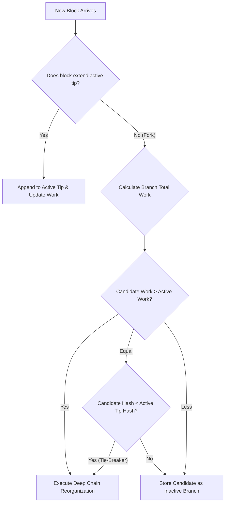

# BlockBum Protocol Specification — Chapter 03: Consensus Rules & Fork-Choice Behavior

**Protocol Version:** 1.0  
**Specification Document:** BB-SPEC-03  
**Status:** Normative  

---

## 1. Consensus Architecture Overview

BlockBum supports a modular consensus abstraction (`IConsensusEngine`) providing two distinct operational modes:
1. **Proof-of-Work (PoW) Nakamoto Engine:** The normative permissionless consensus mechanism for public Mainnet and Testnet environments.
2. **Proof-of-Authority (PoA) DevNet Engine:** A deterministic, zero-energy round-robin consensus mechanism reserved exclusively for local development, rapid unit testing, and sandbox clusters.

All conforming public nodes MUST operate using the Proof-of-Work engine for mainnet transaction validation.

---

## 2. Proof-of-Work (PoW) Nakamoto Consensus Specification

BlockBum Nakamoto PoW guarantees permissionless security through SHA-256 computational proof.

### 2.1 Mining Target & Puzzle Condition
A candidate block is valid under PoW if and only if the SHA-256 hash of its serialized 92-byte `BlockHeader` exhibits at least $D$ leading zero bits:

$$\text{count\_leading\_zero\_bits}(\text{block\_hash}) \ge D$$

where:
$$\text{block\_hash} = \text{SHA-256}(\text{BlockHeader::serialize}())$$

### 2.2 Leading Zero Bit Counting Algorithm
The bit-counting function inspects bytes from index 0 through 31:
- For each byte equal to `0x00`, 8 leading zero bits are accumulated.
- On the first non-zero byte, the most significant bits (MSB $\to$ LSB) are inspected until the first `1` bit is encountered.

### 2.3 Dynamic Difficulty Retargeting
To maintain a stable block production cadence despite fluctuating global hash rates, BlockBum employs a damped dynamic difficulty retargeting algorithm:

| Parameter | Value | Interpretation |
| :--- | :--- | :--- |
| `target_block_time_s` | 10 seconds | Target block interval |
| `retarget_interval` | 10 blocks | Retargeting window |
| `MIN_DIFFICULTY_BITS` | 1 bit | Minimum difficulty floor |
| `MAX_DIFFICULTY_BITS` | 32 bits | Maximum difficulty ceiling for unit-type safety |

#### Retargeting Formula
At block height $H$:
1. If $H = 0$ or $H \pmod{\text{retarget\_interval}} \neq 0$, the required difficulty remains identical to the parent block:
   $$D_H = D_{H-1}$$
2. If $H > 0$ and $H \pmod{\text{retarget\_interval}} = 0$:
   - Calculate actual duration:
     $$\Delta T = \text{timestamp}(H-1) - \text{timestamp}(H - \text{retarget\_interval})$$
   - Calculate expected duration:
     $$T_{\text{expected}} = \text{retarget\_interval} \times \text{target\_block\_time\_s} = 10 \times 10 = 100 \text{ seconds}$$
   - Apply damped adjustment rules:
     - **Too fast ($\Delta T < T_{\text{expected}} / 2$):** Miners solved blocks in less than 50 seconds $\implies D_H = \min(D_{H-1} + 1, 32)$.
     - **Too slow ($\Delta T > T_{\text{expected}} \times 2$):** Miners took longer than 200 seconds $\implies D_H = \max(D_{H-1} - 1, 1)$.
     - **Stable ($T_{\text{expected}} / 2 \le \Delta T \le T_{\text{expected}} \times 2$):** $D_H = D_{H-1}$.

---

## 3. Proof-of-Authority (PoA) Consensus Specification (DevNet)

For private devnets and testing environments:
1. An ordered list of authorized validator identifiers $V = [v_0, v_1, \dots, v_{k-1}]$ is defined at network bootstrap.
2. The authorized proposer for height $H$ is strictly determined by modulo arithmetic:
   $$\text{Proposer}(H) = V[H \pmod k]$$
3. Block validation requires that the first transaction in `block.transactions` (the block creation transaction) has `sender == Proposer(H)`.
4. If $V$ is empty, any peer labeled `"DevNode"` is accepted.

---

## 4. Fork-Choice Rule: Heaviest Accumulated Chain Work

BlockBum implements the **Heaviest Accumulated Work** fork-choice rule (Nakamoto rule). Nodes DO NOT follow the longest chain; nodes follow the chain that represents the greatest total computational work.

### 4.1 Block Work Metric
The work contributed by a single block header is defined as:
$$W(\text{header}) = 2^{\min(D, 31)}$$
For PoA chains, each block contributes uniform work $W(\text{header}) = 1$.

### 4.2 Cumulative Chain Work
The total work of a chain branch $C$ terminating at tip block $B_n$ is:
$$\text{TotalWork}(C) = \sum_{i=0}^n W(B_i)$$

### 4.3 Fork Resolution & Tie-Breaking
When an incoming block $B_{\text{cand}}$ creates an alternate branch competing with active tip $B_{\text{active}}$:

1. **Strictly Heavier Work:**  
   If $\text{TotalWork}(C_{\text{cand}}) > \text{TotalWork}(C_{\text{active}})$, the candidate branch MUST be adopted as the new canonical chain.
2. **Deterministic Tie-Breaker:**  
   If $\text{TotalWork}(C_{\text{cand}}) = \text{TotalWork}(C_{\text{active}})$, the branch whose tip block hash is **lexicographically smaller** (when compared as a 32-byte unsigned big-endian value) MUST be adopted. This ensures 100% deterministic convergence across all network peers during network partitions without split brain.

---

## 5. Chain Reorganization & Finality

### 5.1 Deep Reorganization Invariants
When switching to a heavier branch:
1. The node identifies the **Lowest Common Ancestor (LCA)** between the active tip and the candidate tip.
2. **Reorganization Depth Limit:**  
   $$\text{depth} = \text{height}(B_{\text{active}}) - \text{height}(\text{LCA})$$
   If $\text{depth} > \text{MAX\_REORG\_DEPTH}$ (100 blocks), the reorganization MUST be rejected, and the candidate branch MUST be flagged as invalid.
3. **Atomic State Transition:**
   - All blocks from $B_{\text{active}}$ down to $\text{LCA} + 1$ are reverted (balances restored, nonces decremented).
   - All blocks from $\text{LCA} + 1$ up to $B_{\text{cand}}$ are sequentially executed against the ledger.
   - If any transaction in the new branch fails validation, the reorganization MUST abort and roll back to $B_{\text{active}}$.

### 5.2 Transaction Confirmation & Finality
- **1 Confirmation:** Accepted into active tip block.
- **6 Confirmations:** Standard economic safety against shallow reorgs.
- **100 Confirmations:** Absolute cryptographic finality (immutable; exceeds `MAX_REORG_DEPTH`).

---

## 6. Block Validation Pipeline Summary

A conforming node MUST execute the following checks in order before accepting any block:

1. **Transaction Integrity:** For each $T_i$, verify $\text{SHA-256}(\text{serialize\_for\_id}(T_i)) = T_i.\text{tx\_id}$.
2. **Merkle Root Match:** Compute $\text{MerkleTree::compute\_root}([\text{tx\_id}_0, \dots])$ and assert equality with `header.merkle_root`.
3. **Block Hash Match:** Compute $\text{SHA-256}(\text{header.serialize}())$ and assert equality with `block_hash`.
4. **Linkage Check:** If $H > 0$, assert `header.previous_hash == parent.block_hash` and `header.height == parent.height + 1`.
5. **Monotonic Timestamp:** If $H > 0$, assert `header.timestamp >= parent.header.timestamp`.
6. **Consensus Satisfaction:** Assert $\text{count\_leading\_zero\_bits}(\text{block\_hash}) \ge D$.
7. **Ledger Execution:** Execute all transactions against account ledger; assert zero balance deficits and valid sequential nonces.
