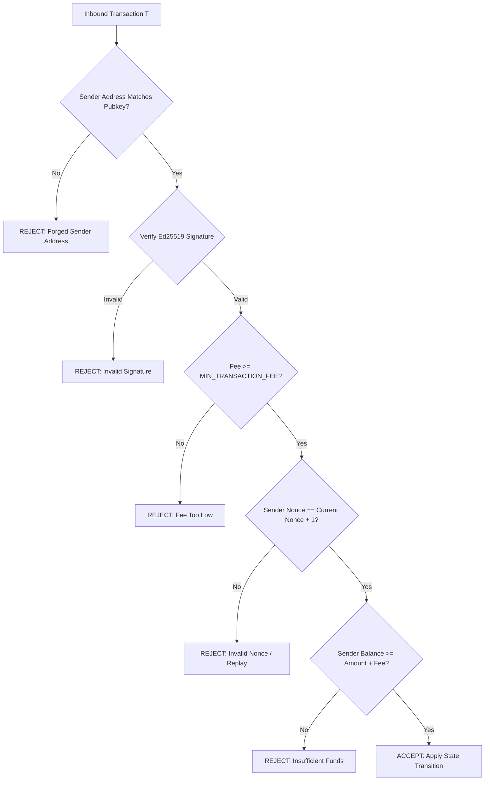

# BlockBum Protocol Specification — Chapter 04: Account State Machine & Token Economics

**Protocol Version:** 1.0  
**Specification Document:** BB-SPEC-04  
**Status:** Normative  

---

## 1. Account State Model Overview

BlockBum utilizes a deterministic, account-based ledger model (similar to Ethereum) rather than an unspent transaction output (UTXO) model. Each distinct user identity or smart contract address is tracked as an entry in the global account state.

### 1.1 Account State Record
An account entry consists of two fundamental fields:

```
+-------------------------------------------------------------------------+
|                        Account State Data Structure                     |
+--------------------+--------------+-------------------------------------+
| Field Name         | Type         | Description                         |
+--------------------+--------------+-------------------------------------+
| balance            | uint64_t     | Current balance in atomic micro-units|
| nonce              | uint64_t     | Sequential transaction counter      |
+--------------------+--------------+-------------------------------------+
```

- **`balance`:** Represents the liquid spending capacity of the account, denominated in atomic units ($10^{-6}$ BUM).
- **`nonce`:** A strictly monotonically increasing counter representing the number of transactions successfully executed by this account. Nonces prevent transaction replay attacks across forks or restarts.

---

## 2. Token Economics & Monetary Supply Policy

BlockBum adheres to a provably scarce, predictable monetary policy anchored by algorithmic halving:

| Parameter | Normative Value | Human-Readable Description |
| :--- | :--- | :--- |
| `BUM_DECIMALS` | `1,000,000` | 6 decimal places ($1\text{ BUM} = 10^6\text{ atomic units}$) |
| `MAX_BUM_SUPPLY` | `21,000,000,000,000` | 21,000,000 BUM absolute maximum supply ceiling |
| `INITIAL_BLOCK_REWARD` | `50,000,000` | 50.0 BUM per block subsidy at Genesis |
| `HALVING_INTERVAL` | `210,000` blocks | Halving period (~4 years at 10-minute blocks) |
| `MIN_TRANSACTION_FEE` | `1,000` atomic units | 0.001 BUM minimum transaction priority fee |

### 2.1 Mathematical Proof of 21,000,000 BUM Supply Limit
The block reward for any block at height $H$ is computed deterministically:

$$\text{halvings} = \lfloor H / 210,000 \rfloor$$

$$\text{BlockReward}(H) = \begin{cases} \text{INITIAL\_BLOCK\_REWARD} \gg \text{halvings}, & \text{if } \text{halvings} < 64 \\ 0, & \text{if } \text{halvings} \ge 64 \end{cases}$$

The total asymptotic coin issuance over the lifetime of the network is given by the geometric progression:

$$\text{TotalSupply} = 210,000 \times \sum_{i=0}^{63} \frac{50}{2^i} = 210,000 \times 50 \times \left( \sum_{i=0}^{\infty} \left(\frac{1}{2}\right)^i \right) = 10,500,000 \times 2 = \mathbf{21,000,000\text{ BUM}}$$

Conforming implementations MUST enforce this halving logic. Any block containing a coinbase subsidy exceeding `calculate_block_reward(height)` MUST be rejected as invalid.

---

## 3. Transaction Validation Pipeline

Before applying a transaction $T$ to the ledger state, a node MUST verify seven strict preconditions:



### 3.1 Precondition Verifications

1. **Address Authenticity Invariant:**  
   The transaction sender string MUST match the address derived from the provided 32-byte public key:
   $$\text{expected\_sender} = \text{"bb1"} + \text{to\_hex}(T.\text{sender\_pubkey})[0..40]$$
   If $T.\text{sender} \neq \text{expected\_sender}$, the transaction MUST be rejected.

2. **Cryptographic Signature Verification:**  
   The signature MUST be verified using RFC 8032 Ed25519 over the transaction pre-image:
   $$\text{Ed25519\_Verify}(T.\text{signature}, T.\text{sender\_pubkey}, \text{serialize\_for\_id}(T)) == \text{true}$$

3. **Transaction Fee Floor:**  
   $$T.\text{fee} \ge \text{MIN\_TRANSACTION\_FEE}\ (1,000\text{ atomic units})$$

4. **Replay Protection Nonce Check:**  
   The transaction nonce MUST strictly equal the sender's current nonce plus one:
   $$T.\text{nonce} = \text{Account}(T.\text{sender}).\text{nonce} + 1$$

5. **Solvency & Arithmetic Overflow Checks:**  
   The total debit is computed with saturation/overflow checks:
   $$\text{debit} = T.\text{amount} + T.\text{fee}$$
   $$\text{assert}(\text{debit} \ge T.\text{amount})$$
   $$\text{assert}(\text{Account}(T.\text{sender}).\text{balance} \ge \text{debit})$$

---

## 4. State Transition Execution

Upon successful validation of block $B$ at height $H$:

1. **Transaction Application:**  
   For each transaction $T \in B.\text{transactions}$:
   - Deduct total debit from sender:
     $$\text{Account}(T.\text{sender}).\text{balance} \leftarrow \text{Account}(T.\text{sender}).\text{balance} - (T.\text{amount} + T.\text{fee})$$
     $$\text{Account}(T.\text{sender}).\text{nonce} \leftarrow T.\text{nonce}$$
   - Credit transfer amount to recipient:
     $$\text{Account}(T.\text{recipient}).\text{balance} \leftarrow \text{Account}(T.\text{recipient}).\text{balance} + T.\text{amount}$$
   - Accumulate block fees:
     $$\text{total\_fees} \leftarrow \text{total\_fees} + T.\text{fee}$$

2. **Coinbase Reward Credit:**  
   The block proposer / miner receives the block subsidy plus the total fees:
   $$\text{miner\_reward} = \text{calculate\_block\_reward}(H) + \text{total\_fees}$$
   $$\text{Account}(B.\text{miner}).\text{balance} \leftarrow \text{Account}(B.\text{miner}).\text{balance} + \text{miner\_reward}$$

3. **Total Supply Tracking:**  
   $$\text{TotalSupply} \leftarrow \text{TotalSupply} + \text{calculate\_block\_reward}(H)$$
   Assert $\text{TotalSupply} \le \text{MAX\_BUM\_SUPPLY}$.
