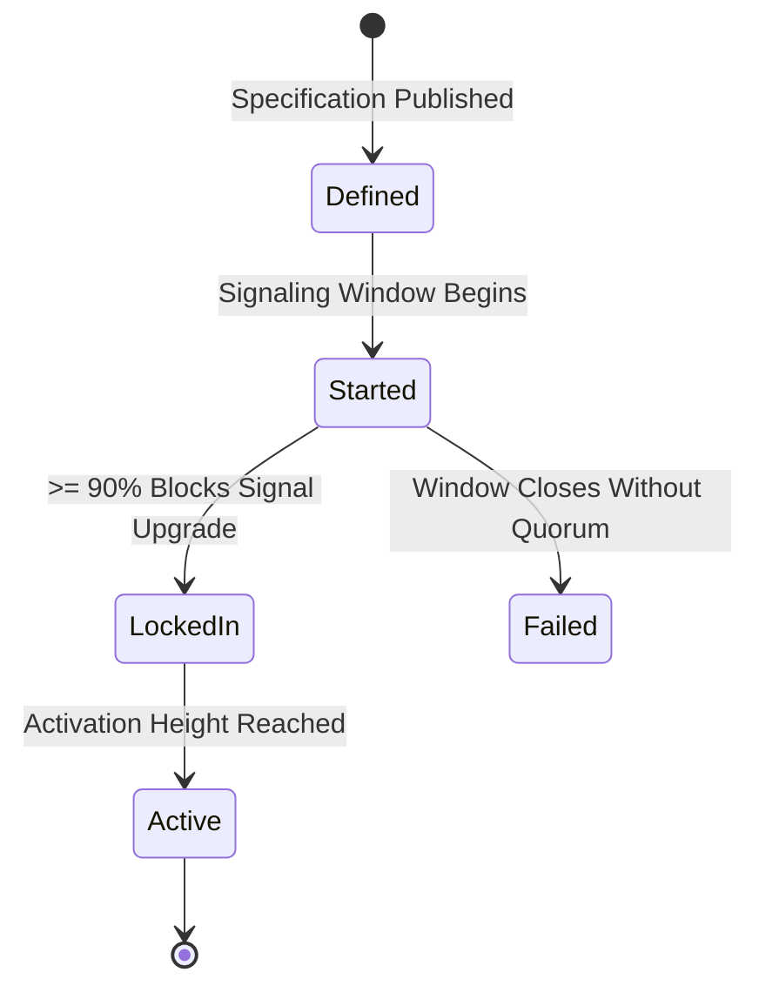

# BlockBum Protocol Specification — Chapter 07: Error Codes, Compatibility & Protocol Upgrades

**Protocol Version:** 1.0  
**Specification Document:** BB-SPEC-07  
**Status:** Normative  

---

## 1. Canonical Protocol Error Registry

To enable seamless inter-client diagnostics, debugging, and deterministic fault handling, BlockBum defines standard error codes grouped into three protocol layers:

### 1.1 Network & Wire Framing Errors (100–199)

| Code | Identifier | Description | Peer Action |
| :---: | :--- | :--- | :--- |
| **101** | `ERR_BAD_MAGIC` | Wire frame does not start with magic `0x4D554242`. | Immediate disconnect. |
| **102** | `ERR_UNSUPPORTED_VERSION` | Advertised wire version is incompatible. | Graceful disconnect. |
| **103** | `ERR_FRAME_TOO_LARGE` | Declared `payload_size` exceeds 10 MiB limit. | Immediate disconnect. |
| **104** | `ERR_MALFORMED_PAYLOAD` | Buffer underflow or invalid binary encoding during parsing. | Drop frame; log warning. |
| **105** | `ERR_DUPLICATE_MESSAGE` | Hash already exists in node's seen message cache. | Silently discard. |
| **106** | `ERR_PEER_TIMEOUT` | No keepalive response received within 90-second window. | Terminate connection. |

### 1.2 Consensus & Validation Errors (200–299)

| Code | Identifier | Description | Severity |
| :---: | :--- | :--- | :--- |
| **201** | `ERR_INVALID_BLOCK_HASH` | Block header hash does not match claimed `block_hash`. | Critical: Reject block. |
| **202** | `ERR_INVALID_MERKLE_ROOT` | Merkle root calculated over transactions does not match header. | Critical: Reject block. |
| **203** | `ERR_INVALID_PREVIOUS_HASH` | Block does not link to known parent block (orphan). | High: Buffer orphan. |
| **204** | `ERR_INVALID_HEIGHT` | Block height does not strictly equal `parent.height + 1`. | Critical: Reject block. |
| **205** | `ERR_INSUFFICIENT_POW` | Block hash leading zero bits less than target difficulty $D$. | Critical: Reject block. |
| **206** | `ERR_TIME_WARP` | Block timestamp earlier than parent timestamp. | Critical: Reject block. |
| **207** | `ERR_REORG_TOO_DEEP` | Competing branch fork depth exceeds `MAX_REORG_DEPTH` (100). | Critical: Reject branch. |
| **208** | `ERR_POA_UNAUTHORIZED` | Block creator is not scheduled authority for given height. | Critical: Reject block. |

### 1.3 Transaction & State Errors (300–399)

| Code | Identifier | Description | Severity |
| :---: | :--- | :--- | :--- |
| **301** | `ERR_TX_MALFORMED` | Deserialization of transaction binary payload failed. | Mempool rejection. |
| **302** | `ERR_TX_INVALID_SIGNATURE` | RFC 8032 Ed25519 signature check failed on pre-image. | Mempool rejection. |
| **303** | `ERR_TX_FORGED_SENDER` | Sender address does not match public key prefix. | Mempool rejection. |
| **304** | `ERR_TX_INSUFFICIENT_FEE` | Fee is strictly less than `MIN_TRANSACTION_FEE` (1,000). | Mempool rejection. |
| **305** | `ERR_TX_NONCE_MISMATCH` | Transaction nonce does not match `account.nonce + 1`. | Mempool rejection. |
| **306** | `ERR_TX_INSUFFICIENT_BALANCE` | Account balance less than `amount + fee`. | Mempool rejection. |
| **307** | `ERR_TX_SUPPLY_OVERFLOW` | Coin generation exceeds maximum cap of 21,000,000 BUM. | Critical ledger fault. |

---

## 2. Protocol Upgrade Rules (Hard Forks & Soft Forks)

BlockBum adheres to strict governance and activation rules to ensure backward compatibility and prevent unintended chain splits.

### 2.1 Soft Forks (Tightening Rules)
- A soft fork introduces a **stricter set of consensus rules**.
- Any block valid under the new rules remains valid under the older rules.
- Non-upgraded nodes will continue to recognize and follow the canonical chain provided a majority of hash rate has upgraded.
- *Examples:* Introduction of stricter script validation, new transaction signature encodings, lower maximum block sizes.

### 2.2 Hard Forks (Loosening or Modifying Rules)
- A hard fork introduces **rule changes that older software would consider invalid**.
- Requires 100% of network nodes to upgrade prior to activation height $H_{\text{fork}}$.
- Any node running older software will diverge onto an abandoned branch upon reaching $H_{\text{fork}}$.
- *Examples:* Alteration of block header structure, changing halving intervals, increasing maximum supply.

---

## 3. Miner Signaling & Coordinated Activation (BIP-9 Style)

Protocol upgrades MUST follow a formal 4-phase activation lifecycle:

### 3.1 Signaling Specification
1. **Signaling Mechanism:** Miners signal readiness by setting designated bitflags in `BlockHeader.version`.
2. **Signaling Window:** 2,016 blocks (~14 days).
3. **Activation Threshold:** At least 90% of blocks (1,814 out of 2,016) within a window must signal support.
4. **Grace Period:** Once locked in, a grace period of 4,032 blocks (~28 days) is enforced before new consensus rules execute, ensuring client operators have ample time to update binaries.

---

## 4. Migration & Deprecation Lifecycle

1. **Deprecation Notice:** Features scheduled for deprecation MUST be flagged as deprecated for at least 3 minor releases or 6 months prior to removal.
2. **Backward-Compatible Interfaces:** Node RPCs MUST maintain backward compatibility with previous client versions by retaining legacy endpoints alongside newer v2 methods.
3. **Testnet Staging:** Any consensus change MUST operate continuously on the public Testnet for at least 30 consecutive days without consensus divergence prior to mainnet activation.
